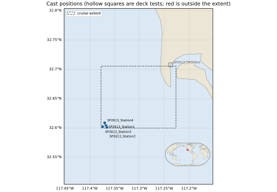
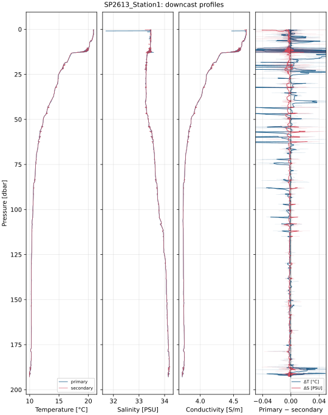
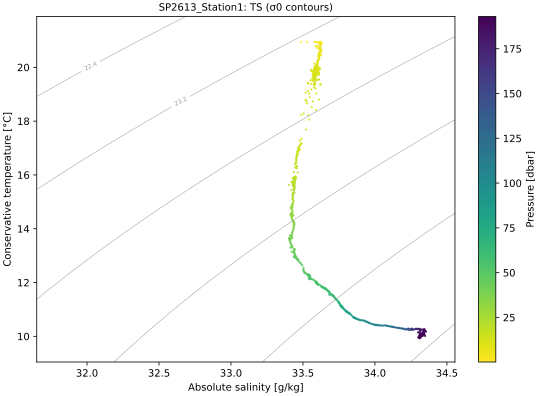
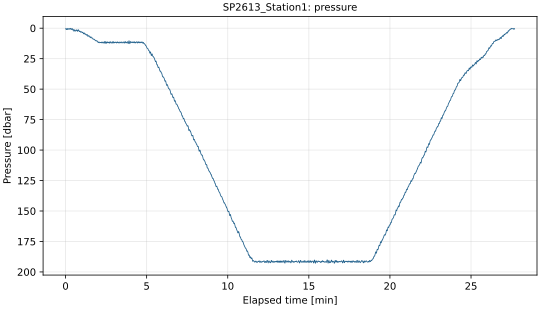

# sbe-qa-processing

> [!WARNING]
> **Under heavy development.** This project is shared for peer review. Its outputs, command
> line, config format and Python API may change without notice, and its results haven't been
> validated beyond the R2R filesets listed under [Validation against R2R](#validation-against-r2r).
> Don't rely on it for operational QA yet. Issues and comments are welcome.

Quality assessment for Sea-Bird **SBE 9/911plus** CTD casts. Point it at a directory of raw
Seasave files (`.hex/.dat`, `.XMLCON/.con`, `.hdr`, `.bl`) or a BagIt bag, optionally with a
small config, and it checks the files and the data and writes:

| Output | Contents |
|---|---|
| `<TITLE>_qa_report.pdf` | Under the title, the checks in a line on the worst status's color (which integrity checks didn't pass, and which casts warned or failed the science checks); a cast map with coastlines and a world inset; the fileset's integrity checks; and per cast: profiles, dual-sensor differences, TS diagram, pressure record, integrity and science checks and sensor loadout |
| `<TITLE>_plots/*.svg` | Every report figure as SVG: the cast map, and each cast's profiles, TS diagram and pressure record. The PDF embeds these same SVGs as vector graphics |
| `<TITLE>_qa.ipynb` | A notebook that re-runs the whole assessment step by step, to inspect or change it (see [Opening the notebook](#opening-the-notebook)) |

`<TITLE>` is the config's cruise ID, or the fileset directory's name without one.

Two optional integrations build on this:
- **[R2R](#r2r)** (Rolling Deck to Repository) adds R2R's CTD tests, its rating and its QA 2.0
  XML, identical to R2R's own reports.
- **[OpenVDM](#openvdm)** runs the QA from a post-transfer hook on each cruise's CTD files.

**[docs/examples](docs/examples/)** has what it writes for a real cruise, SP2613: the PDF reports
from `run` and `r2r run`, the cast map, one cast's figures and the R2R QA 2.0 XML. The cast map
and Station 1's figures, as the PDF shows them:

<table>
<tr>
<td colspan="2" align="center"></td>
</tr>
<tr>
<td rowspan="2" width="50%"></td>
<td></td>
</tr>
<tr>
<td></td>
</tr>
</table>

[COOKBOOK.md](COOKBOOK.md) works through both, end to end, with real output: a directory of
Seasave files with and without a config, and an R2R fileset from download to comparing ratings
with R2R's report.

Raw `.hex` data is read and converted with
[seabirdscientific](https://github.com/Sea-BirdScientific/seabirdscientific) 3.0.0 or later
(see [seabirdscientific version](#seabirdscientific-version)).
The `.XMLCON` parser lives here, since seabirdscientific doesn't have one.

## Setup

Requires Python 3.11+, [uv](https://docs.astral.sh/uv/) and git. **[INSTALL.md](INSTALL.md)** has
the commands for macOS, Debian and Ubuntu, RHEL, AlmaLinux and Rocky Linux, and Windows, the
install for the OpenVDM hook, the map data, and installing for a ship without internet. In
short:

```bash
git clone https://github.com/OceanDataTools/sbe-qa-processing.git
cd sbe-qa-processing
uv sync
uv run pytest
```

## Usage

```bash
uv run sbe-qa-processing run path/to/fileset -o output/MYCASTS
uv run sbe-qa-processing run path/to/fileset -c my_config.toml -o output/MYCASTS --execute-notebook
```

Without `-c`, the reports are titled after the fileset directory, and the integrity checks
that need an expected area or dates are n/a. A [config TOML](#config-toml) sets those, the
thresholds and the report's details; every field is optional.

**[COOKBOOK.md](COOKBOOK.md)** walks through whole workflows with real output: a directory of
Seasave files (a quick look, a config TOML, a changed threshold, the notebook, Python), and an
R2R fileset (downloading it, its cruise TOML, R2R's assessment, comparing with R2R's report).

### Command line

`sbe-qa-processing --help` lists the commands, and `sbe-qa-processing COMMAND --help` (or
`sbe-qa-processing r2r COMMAND --help`) documents each one. `sbe-qa-processing --version`
prints the version. The core commands are `run` and
`fetch-map-data`; the [R2R commands](#r2r-commands) are a group under `r2r`, and the
[OpenVDM commands](#openvdm-commands) are `openvdm`, `config-from-openvdm` and `site-config`.

Every command follows these conventions:
- `-o/--output` is a directory; only `site-config` writes a single file. Commands that make a
  cruise TOML write `<OUTPUT_DIR>/<CRUISE_ID>.toml` (default `configs/`), or to stdout with
  `-o -`.
- Existing outputs, reports included, aren't overwritten without `--force`. The exception is
  the `openvdm` hook, which replaces its reports after each transfer.
- A command exits 0 on success and 1 when it refuses (e.g. existing outputs) or fails with an
  expected error (a server that can't be reached, a fileset directory that isn't there, a bad
  config or theme, R2R or OpenVDM not having what was asked for), with a one-line message on
  stderr, e.g.
  `sbe-qa-processing: couldn't reach R2R (service.rvdata.us): ... Check the network connection and try again`.
- `-v`/`--verbose`, before or after the command, logs more: `-v` is INFO and `-vv` is DEBUG
  (default WARNING). `-vv` also prints the traceback of an expected error, e.g.
  `sbe-qa-processing r2r fetch-fileset SP2613 169847 -vv`.

#### `run`

```text
sbe-qa-processing run [-c CONFIG_TOML] [-o OUTPUT_DIR] [--force] [--execute-notebook]
                      [--theme THEME_TOML] FILESET_DIR
```

Assesses a fileset with the integrity and science checks, and writes the PDF, the SVG plots and
the notebook.

| Argument | Default | Description |
|---|---|---|
| `FILESET_DIR` | required | A directory of casts, searched recursively, or a BagIt bag (a directory with `bagit.txt`, `manifest-md5.txt` and the casts under `data/`). A cast's `.hex`/`.dat`, `.XMLCON`/`.con`, `.hdr` and `.bl` files are matched by name, ignoring case. Casts whose names contain `deck`, `dock` or `test` are deck tests |
| `-c`, `--config CONFIG_TOML` | none | A [config TOML](#config-toml). Without one, the reports are titled after `FILESET_DIR` |
| `-o`, `--output OUTPUT_DIR` | `output` | Directory for the reports, created if needed |
| `--force` | off | Replace existing reports; without it, `run` stops if any of them exists |
| `--execute-notebook` | off | Run the notebook (needs `nbclient` and `ipykernel`, in the dev group) and save it with its outputs |
| `--theme THEME_TOML` | none | A [theme](#themes) file; the config's `[theme]` applies on top |

It writes `<TITLE>_qa_report.pdf`, `<TITLE>_plots/*.svg` and `<TITLE>_qa.ipynb` into
`OUTPUT_DIR`, where `<TITLE>` is the config's `[cruise] id`, or the fileset directory's name.
It prints a summary: the number of casts, then each integrity check and science check that warned
or failed.

#### `fetch-map-data`

```text
sbe-qa-processing fetch-map-data
```

Downloads the Natural Earth layers the cast map uses (1:10m land, lakes and coastlines, and the
1:110m world for the inset, about 27 MB) into cartopy's data directory, so the maps have
coastlines offline, e.g. at sea. It takes no arguments.

With the environment variable `SBE_QA_NO_MAP_DATA` set, no layer is loaded or downloaded, and
the maps are drawn without coastlines. The tests set it.

### Config TOML

A config TOML describes the cruise for the reports, sets the expected area and dates for the
integrity checks, and tunes the science checks. Every table and key is optional; leave out
what you don't know. `configs/config.example.toml` shows every key, with each threshold at its
default. A complete example:

```toml
[cruise]
id = "LAKE1"                          # the reports' title and file name prefix
name = "Lake Michigan spring survey"  # under the title
pi = "A. Scientist"                   # report header details, shown when given
location = "Southern Lake Michigan"
vessel_name = "Blue Heron"
depart_date = 2026-07-09              # expected cast dates: TOML dates, not strings
arrive_date = 2026-07-10

[cruise.extent]                       # expected cast area [decimal degrees, east and north positive]
westernmost = -88.0
easternmost = -87.0
southernmost = 42.0
northernmost = 43.0

[fileset]
manifest = "MD5_Summary.txt"          # checksums for a plain directory; relative to this file

[provenance]                          # the report contact, in the header
contact_institution = "Large Lakes Observatory"
contact_email = "ship-tech@example.org"

[thresholds]                          # science check limits; defaults below
salinity_range = [0.0, 2.0]           # fresh water
conductivity_range = [0.0, 0.2]

[theme]                               # the reports' look; see Themes
page_size = "A4"
```

| Table | Key | Used for |
|---|---|---|
| `[cruise]` | `id` | The reports' title and file names. Default: the fileset directory's name. In file names, characters that aren't valid in a file name on every platform (`/ \ < > : " \| ? *`, control characters) become `_`, with a warning; the title keeps the ID as given |
| | `name`, `pi`, `location`, `vessel_name` | The report header, when given |
| | `depart_date`, `arrive_date` | "Cast time inside the expected dates" (needs both; n/a without them) |
| `[cruise.extent]` | `westernmost`, `easternmost`, `southernmost`, `northernmost` | "Position inside the expected area" (n/a without it) and the box on the cast map. All four are needed. A box across the antimeridian has `westernmost` > `easternmost`, e.g. 178 to -178 |
| `[fileset]` | `manifest` | A checksum file for a plain directory: `<md5> <path>` lines with paths relative to the manifest's directory, as in OpenVDM's MD5 summary. Lines without a real hash are skipped, and files changed after the manifest was written count as pending. A BagIt bag uses its own `manifest-md5.txt` instead |
| `[provenance]` | `contact_institution`, `contact_email` | The report header |
| `[thresholds]` | see below | The science checks |
| `[theme]` | see [Themes](#themes) | The PDF, figures and notebook |

`[thresholds]`, with their defaults. Ranges are `[low, high]` arrays.

| Key | Default | Check |
|---|---|---|
| `temperature_difference` | `0.01` [°C] | Dual temperature difference: median of \|primary − secondary\| below `dual_sensor_min_pressure`. Warns up to twice the limit, then fails |
| `conductivity_difference` | `0.001` [S/m] | Dual conductivity difference, as above |
| `salinity_difference` | `0.01` [PSU] | Dual salinity difference, as above |
| `dual_sensor_min_pressure` | `20.0` [dbar] | Depth below which the dual-sensor differences are taken, leaving out the surface layer |
| `temperature_range` | `[-2.5, 40.0]` [°C] | Plausible range: passes with no scans outside, warns under 1% outside, else fails |
| `conductivity_range` | `[0.0, 7.0]` [S/m] | Plausible range, pumped scans only |
| `salinity_range` | `[2.0, 42.0]` [PSU] | Plausible range, pumped scans only; lower it for fresh water |
| `pressure_range` | `[-5.0, 11000.0]` [dbar] | Plausible range |
| `max_spike_percent` | `0.5` [%] | Share of scans Wild Edit flags (2 and 20 standard deviations, 100-scan blocks). Warns up to twice the limit |
| `max_lost_scan_percent` | `0.1` [%] | Share of scans missing from the modulo counter. Warns up to ten times the limit |
| `max_calibration_age_days` | `365` [days] | Sensors calibrated longer ago than this at the time of the cast warn |

Parsing rules:
- An unknown key is an error, so a typo doesn't go unnoticed. The message names every one and
  where it belongs, e.g. `[cruise] depart_dat: did you mean depart_date?` or
  `extent (top level): did you mean [cruise.extent]?`.
- So is a value of the wrong shape (a value where a table belongs, or the reverse), a date
  that isn't a TOML date, or a `[cruise.extent]` without all four edges.
- The keys of an [R2R cruise TOML](#r2r-cruise-toml) are accepted and left to the `r2r`
  commands, so an R2R cruise TOML or an OpenVDM snapshot works as a config too.
- Relative paths (`[fileset] manifest`, theme fonts and logo) are relative to the TOML file.

### Themes

The PDF, its figures and the notebook can take a house style: page size and margins, fonts,
text sizes, colors, a logo and the footer. Pass a theme file with `--theme` (`run`, `r2r run`
and the `openvdm` hook), or set a `[theme]` table in the config, which applies over the file's
settings. `configs/theme.example.toml` shows every setting:

```bash
uv run sbe-qa-processing run path/to/fileset --theme configs/theme.example.toml -o output/MYCASTS
```

```toml
[theme]                     # in a config TOML
page_size = "A4"
logo = "logo.png"           # relative to the TOML file
organization = "Example Oceanographic Institution"
palette = "colorblind"      # Okabe-Ito colors, distinct with common color vision deficiencies

[theme.colors]
water = "#e6f0f7"
```

Without a theme, the reports look as they always have. The notebook re-creates the same theme,
so figures re-run there match the PDF. For the OpenVDM hook, a `[theme]` table can also go in
the site TOML. Fonts must be TrueType (`.ttf`); with `font_scale` above about 1.05, narrow
table headers such as "Status" wrap.

### Opening the notebook

The notebook imports this package and seabirdscientific, so it has to run on the project's
Python (`.venv`), not on the Python of whichever Jupyter opens it. A Jupyter installed with
Homebrew, Anaconda or pip starts its own Python by default. That Python doesn't have this
project's packages, so the first cell fails with
`ModuleNotFoundError: No module named 'matplotlib'` (or `'sbe_qa_processing'`). There are two
ways to fix this.

**Run JupyterLab from the project.** Nothing to set up, and nothing is added to `.venv` or
`uv.lock`:

```bash
uv run --with jupyterlab jupyter lab output/MYCASTS/MYCASTS_qa.ipynb
```

**Or use the Jupyter you already have.** Register the project's Python as a kernel, once per
checkout:

```bash
uv run python -m ipykernel install --user --name sbe-qa-processing --display-name "Python (sbe-qa-processing)"
```

Then, in each notebook, choose **Kernel → Change Kernel… → Python (sbe-qa-processing)**. The
generated notebooks ask for the default `python3` kernel, so do this for each new one. Some
notes on this way:
- It needs `ipykernel` from the dev group, so it doesn't work after `uv sync --no-dev`.
- The kernel runs `.venv` at the path where you registered it. If you move the checkout or
  delete `.venv`, register it again.
- `jupyter kernelspec list` shows the registered kernels, and
  `jupyter kernelspec uninstall sbe-qa-processing` removes this one.

The notebook's paths to the fileset, the config, the theme and the output directory are
absolute, so it doesn't matter where Jupyter starts. `--execute-notebook` runs the notebook
with the project's Python and needs neither setup.

## What it checks

**Integrity checks** (PDF, notebook and the command's summary), for every cast, deck tests
included, and summarized for the fileset:
- Raw files complete (`.hex/.dat`, `.XMLCON/.con`, `.hdr`; `.bl` noted) and readable.
- Checksums against the bag's `manifest-md5.txt` or the config's `[fileset] manifest`; n/a
  without a manifest.
- A valid NMEA position (not 0,0), and the position on every scan.
- A cast time that isn't before 1990 (an unset clock) or in the future, and casts in time order
  by file name.
- Header temperature and conductivity serial numbers match the `.XMLCON`.
- Position inside the config's expected area and time inside its dates (n/a without them,
  and for deck tests).
- A fileset with no casts (no `.hex`, `.dat` or `.hdr` files) warns: most likely the wrong
  directory.
- Informational: the range of cast times and positions, cast count, deck tests, casts with
  bottles fired, instrument model.

**Science checks** (PDF and notebook), per cast that isn't a deck test:
- Primary/secondary temperature, conductivity and salinity agreement below 20 dbar (median).
- Plausible ranges, Wild Edit spikes (seabirdscientific, SBE Data Processing's 2/20 σ settings).
- Lost scans from the modulo counter, pump on in the water.
- Sensor calibration age: warns when a sensor's `.XMLCON` calibration date is more than
  `max_calibration_age_days` (default 365) before the cast.
- Informational: maximum pressure, descent rate and heave, duration, bottle fires.

**Sensor loadout** (PDF and notebook), per cast: the sensor on each frequency and voltage
channel with its serial number, calibration date and age at the time of the cast, and the deck
unit settings (scan rate, suppressed channels, data appended to each scan).

## R2R

The `r2r` commands add R2R's CTD tests, its rating and the R2R QA 2.0 XML. They take a cruise
TOML with R2R's IDs, ports and fileset ID, which come from R2R's catalog:

```bash
# from R2R's catalog API, for a cruise and CTD fileset R2R knows:
uv run sbe-qa-processing r2r config-from-catalog MYCRUISE 123456   # writes configs/MYCRUISE.toml
# or from an existing R2R QA 2.0 report (adds port coordinates):
uv run sbe-qa-processing r2r config-from-qa path/to/r2r_qa.2.0.xml   # configs/MYCRUISE.toml
uv run sbe-qa-processing r2r run configs/MYCRUISE.toml path/to/fileset -o output/MYCRUISE
```

`r2r run` writes the core reports, with R2R's certificate (rating, tests and infos) at the
front of the PDF and in the notebook, named `<CRUISE>_<FILESET>`, plus:

| Output | Contents |
|---|---|
| `<CRUISE>_<FILESET>_qa.2.0.xml` | R2R QA 2.0 rollup report: the same tests, infos, ratings and manifest R2R's `r2r-ctd` produces, in R2R's schema and with its stylesheet reference |

`run -c` takes the same cruise TOML and ignores the R2R fields.

### R2R commands

#### `r2r run`

```text
sbe-qa-processing r2r run [-o OUTPUT_DIR] [--force] [--execute-notebook] [--theme THEME_TOML]
                          CRUISE_TOML FILESET_DIR
```

Assesses a fileset as `run` does, plus R2R's CTD tests, and writes the R2R QA 2.0 XML and the
core reports with R2R's certificate.

| Argument | Default | Description |
|---|---|---|
| `CRUISE_TOML` | required | An [R2R cruise TOML](#r2r-cruise-toml), with the cruise ID and dates |
| `FILESET_DIR` | required | A BagIt bag or directory of casts, as for `run` |
| `-o`, `--output OUTPUT_DIR` | `output` | Directory for the reports |
| `--force` | off | Replace existing reports |
| `--execute-notebook` | off | Run the notebook and save its outputs |
| `--theme THEME_TOML` | none | A [theme](#themes) file; the cruise TOML's `[theme]` applies on top |

It writes `<CRUISE>_<FILESET>_qa.2.0.xml`, `_qa_report.pdf`, `_plots/` and `_qa.ipynb`, where
`<FILESET>` is the R2R fileset ID, or `ctd` without one. It prints the R2R rating and each
test's rating, then the core summary.

#### `r2r config-from-catalog`

```text
sbe-qa-processing r2r config-from-catalog [-o OUTPUT_DIR] [--force] CRUISE_ID FILESET_ID
```

Writes an R2R cruise TOML from R2R's catalog API: the cruise's name, chief scientist, water
body, vessel, operator and scheduler, dates, ports and navigation bounding box. It checks that
`FILESET_ID` is one of the cruise's CTD filesets, and lists them if it isn't.

| Argument | Default | Description |
|---|---|---|
| `CRUISE_ID` | required | R2R cruise ID, e.g. `SP2613` |
| `FILESET_ID` | required | R2R fileset ID, an integer, e.g. `169847` |
| `-o`, `--output OUTPUT_DIR` | `configs` | Directory for `<CRUISE_ID>.toml`, or `-` for stdout |
| `--force` | off | Replace an existing TOML |

The API has no port coordinates, country or state, so the ports have only a name and R2R ID.
Without a navigation bounding box in R2R, it warns and leaves out `[cruise.extent]`; R2R's
location test is then GREY (N) until you add one.

#### `r2r config-from-qa`

```text
sbe-qa-processing r2r config-from-qa [-o OUTPUT_DIR] [--force] R2R_QA_XML
```

Writes an R2R cruise TOML from the fileset info in one of R2R's QA 2.0 reports, including the
ports' coordinates, country and state. Use it to check this tool's results against R2R's.

| Argument | Default | Description |
|---|---|---|
| `R2R_QA_XML` | required | R2R's QA 2.0 XML for the fileset, e.g. the `r2r_qa.2.0.xml` that `r2r fetch-fileset` downloads |
| `-o`, `--output OUTPUT_DIR` | `configs` | Directory for `<CRUISE_ID>.toml`, or `-` for stdout |
| `--force` | off | Replace an existing TOML |

#### `r2r fetch-fileset`

```text
sbe-qa-processing r2r fetch-fileset [-o OUTPUT_DIR] [--force] CRUISE_ID FILESET_ID
```

Downloads a released R2R CTD fileset (a BagIt bag) into
`<OUTPUT_DIR>/<CRUISE_ID>_<FILESET_ID>_ctd/`, with R2R's QA report beside it as
`r2r_qa.2.0.xml` (`r2r_qa.xml` for older filesets).
The report is the one R2R's catalog lists for the fileset (`api/qa_info`); when R2R lists one
but doesn't serve it, the command says so, with R2R's answer, and still downloads the bag.
When R2R answers with an HTTP error (e.g. 503 while its service is down), the command says
which download failed in one line and exits 1. If the bag arrived but the QA report didn't, it
says so: run it again with `--force` to fetch it.

| Argument | Default | Description |
|---|---|---|
| `CRUISE_ID` | required | R2R cruise ID |
| `FILESET_ID` | required | R2R fileset ID, an integer |
| `-o`, `--output OUTPUT_DIR` | `data` | Directory for the fileset's directory |
| `--force` | off | Download into an existing fileset directory |

### R2R cruise TOML

An R2R cruise TOML is a [config TOML](#config-toml) with R2R's catalog details added. It must
have `[cruise] id`, `depart_date` and `arrive_date`. The `r2r config-from-*` commands write it;
this is RR2605's, from R2R's QA report (`tests/configs/RR2605.toml`):

```toml
[cruise]
id = "RR2605"
name = "R/V Roger Revelle Annual Instrumentation Calibrations"
vessel_id = "33RR"                # R2R's vessel ID: the ICES ship code
operator_id = "edu.ucsd.sio"      # R2R organization IDs
scheduler_id = "org.unols"
depart_date = 2026-07-21          # required
arrive_date = 2026-07-24          # required

[cruise.extent]                   # the NAV location test; without it, GREY (N)
westernmost = -118.632308
easternmost = -117.224462
southernmost = 32.61502
northernmost = 33.370637

[cruise.depart_port]              # and [cruise.arrive_port]
name = "San Diego"
port_id = "100055"                # R2R port ID
country_id = "us"
state_id = "ca"
longitude = -117.175
latitude = 32.71667

[cruise.arrive_port]
name = "San Diego"
port_id = "100055"
country_id = "us"
state_id = "ca"
longitude = -117.175
latitude = 32.71667

[fileset]
id = 170644                       # R2R fileset ID; reports are named <CRUISE>_<FILESET>

[provenance]
distro_type = "post-cruise"
```

The keys it adds to a config TOML, all written to the XML:

| Table | Key | Default | Description |
|---|---|---|---|
| `[cruise]` | `id`, `depart_date`, `arrive_date` | required | Also the dates R2R's "Dates within NAV Ranges" test uses |
| | `vessel_id` | blank | R2R's vessel ID, the ICES ship code (e.g. `33RR`) |
| | `operator_id`, `scheduler_id` | blank | R2R organization IDs (e.g. `edu.ucsd.sio`, `org.unols`) |
| `[cruise.depart_port]`, `[cruise.arrive_port]` | `name`, `port_id`, `country_id`, `state_id`, `longitude`, `latitude` | blank | The ports, as in R2R's catalog |
| `[fileset]` | `id` | blank | R2R's fileset ID. Without it, reports are named `<CRUISE>_ctd` |
| `[provenance]` | `distro_type` | `post-cruise` | R2R's distribution type |
| | `contact_institution_id` | blank | The contact institution's R2R organization ID |
| `[thresholds]` | `yellow_minimum_percent` | `50.0` [%] | An R2R NAV test is YELLOW at or above this share of passing casts, else RED |

### R2R tests

Written to the XML and the certificate:
- Presence of all raw files: every cast has `.hex/.dat`, `.XMLCON/.con` and `.hdr`.
- Valid checksums: every file in the bag's `manifest-md5.txt` matches. BLACK (X) without a
  manifest.
- Lat/lon and dates within the cruise extent and dates (deck tests excluded).
- Infos: raw file count, casts with bottles fired, instrument model, casts with NAV on every
  scan, and casts with missing files, unreadable `.hex` or `.XMLCON`, deck tests, sensor serial
  number mismatches (`.hdr` vs `.XMLCON`), or bad/outside navigation.

### Validation against R2R

`tests/test_r2r_comparison.py` runs the tool on two released R2R filesets and requires the
XML's `certificate` (ratings, results, bounds, infos) and manifest to be identical to R2R's own
reports:

| Fileset | R2R | This tool |
|---|---|---|
| SP2613 / 169847 (Sproul) | G | G, certificate identical |
| RR2605 / 170644 (Revelle) | Y (one cast outside the extent) | Y, certificate identical |
| BH18-18 / 132368 (Blue Heron) | no QA 2.0 report | R presence test (a cast with only a `.hdr`), SBE 21 configuration flagged |

They're committed in `tests/data/`, and `uv run pytest` unpacks them into `data/` (e.g.
`data/SP2613_169847_ctd/`). To fetch one from R2R instead, e.g. to check it hasn't changed:

```bash
uv run sbe-qa-processing r2r fetch-fileset SP2613 169847 --force   # into data/SP2613_169847_ctd/
```

R2R doesn't document every rule; the ones inferred here (deck tests excluded from NAV tests, a
NAV test is YELLOW at ≥ 50% of casts, the overall rating counts individual per-cast checks) are
noted in `src/sbe_qa_processing/integrations/r2r/rules.py` and reproduce R2R's ratings for both
filesets.

## OpenVDM

On a ship running [OpenVDM](https://github.com/OceanDataTools/openvdm), the QA runs:
- **During the cruise,** from OpenVDM's `postCollectionSystemTransfer` hook, after each transfer
  of the CTD's collection system that brings new or updated CTD files: a missing file, a sensor
  past its calibration or a cast outside the expected area shows while there's time to act.
- **Afterwards, by hand:** any earlier cruise, from the `cruise_config.json` in its directory
  ([A past cruise](#a-past-cruise)).

Each run writes the core reports (PDF, SVG plots, notebook), not R2R's, into an OpenVDM extra
directory. **Setting it up** (the install, the extra directory, the ship's site TOML and the
hook in `openvdm.yaml`) is in [INSTALL.md](INSTALL.md#install-for-the-openvdm-hook).

### Where its values come from

- **The cruise,** from OpenVDM's API (`api/warehouse/getCruiseConfig`): its ID, name, PI,
  location and dates, its extent (`cruiseExtent`, OpenVDM 2.17), the warehouse directory, the
  transfer's destination, the extra directories and the MD5 summary. For a past cruise, from its
  `cruise_config.json` instead (OpenVDM's per-cruise config file, which its `CRUISE_CONFIG_FN`
  setting names).
- **The vessel's name and contact,** from the site TOML, or where it leaves them blank, from
  `openvdm.yaml`'s `vessel` block (OpenVDM 2.17); a disagreement is noted. With
  `--cruise-config`, from that `cruise_config.json` instead: the vessel the cruise was on.
- **The expected area,** from OpenVDM's `cruiseExtent`, which `build_cruise_tracks.py` sets
  from the ship's track each time the data dashboard runs, else the site TOML's `[extent]`.
  Without either, the area check is n/a.
- **The science checks' limits and the reports' theme,** from the site TOML's `[thresholds]`
  and `[theme]`.

### What the hook does

- **Skips** a transfer whose new or updated files include no `.hex/.dat`, `.XMLCON/.con`, `.hdr`
  or `.bl` (`--changed-files`).
- **Reads** every cast in the transfer's directory, checks its time against the cruise's dates
  (an open-ended cruise ends today, UTC), and **checks the checksums** against OpenVDM's MD5
  summary. Files
  changed after the summary was written count as pending, not failures, since OpenVDM updates
  the summary in parallel with the hook.
- **Writes into the extra directory,** replacing earlier ones: `<cruise>_qa_report.pdf`,
  `<cruise>_plots/`, `<cruise>_qa.ipynb`, and `<cruise>_cruise.toml`, a snapshot of what OpenVDM
  and the site TOML supplied, which the notebook re-runs from. Run as root, it gives them to the
  warehouse user.
- **Adds those files to the cruise's MD5 summary,** with OpenVDM's
  `utils/update_md5_summary.py` (OpenVDM 2.16.1 or later), found from `--openvdm-config`'s
  install directory. The files go by their full paths, so for a cruise from `--cruise-config`
  OpenVDM adds them only if its warehouse has the cruise there. If that fails, the hook logs a
  warning and still succeeds, and the reports reach the summary at its next full rebuild.
- **Takes the extent** as above. A cast near the newest end of the track can fall just outside
  OpenVDM's extent until the next dashboard update; the next hook run then passes it. A box
  across the antimeridian has westernmost > easternmost, as in R2R's reports.
- **Fails in one line,** which OpenVDM shows as the hook's message.
- **Writes the core reports only,** not R2R's. To check a cruise against R2R's tests, use
  `r2r run` with a cruise TOML from R2R's catalog.

### Troubleshooting

OpenVDM logs the hook's output in `/var/log/openvdm/post_hooks.log`. To see it directly, run the
hook's command by hand, as root, without `--changed-files`
([INSTALL.md step 5](INSTALL.md#5-try-it)). Each run prints the cruise it found, what it assumed
(`note:` lines), the QA summary and the files it wrote.

| Message | Meaning |
|---|---|
| `CTD: no new or updated CTD files; nothing to do` | None of the transfer's new or updated files is a CTD file. By hand, leave `--changed-files` out |
| `... doesn't exist yet; nothing to do` | The transfer hasn't brought any files yet |
| `Casts warn (0): no .hex, .dat or .hdr files in ...` | The transfer's directory has no casts: check `TRANSFER` is the CTD's collection system transfer |
| `OpenVDM has no current cruise` | Start a cruise in OpenVDM, or use `--cruise-config` for a past one |
| `note: no site TOML at ...; running without one` | Not an error: neither `--site-config` nor the install's `configs/site.toml`. The QA runs, without `[extent]` when OpenVDM has no cruise extent; `site-config` writes one (INSTALL.md step 3) |
| `no collection system transfer named ...` | `TRANSFER` isn't a transfer's name in OpenVDM (Configuration > Collection System Transfers) |
| `no extra directory named 'CTD_QA'` | Add it in OpenVDM (Configuration > Extra Directories), or set the site TOML's `[openvdm] output_extra_directory` |
| `no openvdm.yaml at ...` | OpenVDM is installed elsewhere: give `--openvdm-config`, or the cruise's `cruise_config.json` with `--cruise-config` |
| `couldn't reach OpenVDM (...)` | OpenVDM's web server isn't answering at `openvdm.yaml`'s `siteRoot` |
| `can't read the cruise config ...`, `... isn't an OpenVDM cruise config`, `... OpenVDM names a cruise's directory after it` | `--cruise-config` needs the `cruise_config.json` in the cruise's own directory, named after the cruise |
| `the reports aren't in OpenVDM's MD5 summary: ...` | OpenVDM's `update_md5_summary.py` is missing (OpenVDM before 2.16.1) or failed. The reports are written all the same |
| `note: OpenVDM has no cruise extent; using the site config's [extent]` | OpenVDM before 2.17, or `build_cruise_tracks.py` hasn't run yet |
| `note: no cruise extent: ...` | Neither OpenVDM nor the site TOML has an extent, so the area check is n/a |
| `note: OpenVDM's cruise has no end date; arrive_date is today, UTC ...` | An open-ended cruise: casts after today fail the dates check |
| `note: vessel_name is ... in the site config and ... in OpenVDM's ...` | The site TOML and OpenVDM disagree; the site TOML's value is used |

### OpenVDM commands

#### `openvdm`

```text
sbe-qa-processing openvdm [--openvdm-config OPENVDM_YAML] [--cruise-config CRUISE_CONFIG_JSON]
                          [--site-config SITE_TOML] [--changed-files FILES]
                          [--execute-notebook] [--theme THEME_TOML] [TRANSFER]
```

The post-transfer hook: assesses the collection system transfer's CTD files for OpenVDM's
current cruise, and writes the reports into an OpenVDM extra directory, replacing earlier ones.
Installed `openvdm.yaml` files call it, so its arguments keep their names.

| Argument | Default | Description |
|---|---|---|
| `TRANSFER` | `CTD` | The collection system transfer's name; in a hook, `{collectionSystemTransferName}` |
| `--openvdm-config OPENVDM_YAML` | `/opt/openvdm/server/etc/openvdm.yaml` | OpenVDM's settings: its web root (`siteRoot`) and, from OpenVDM 2.17, the `vessel` block. Needs the `openvdm` extra |
| `--cruise-config CRUISE_CONFIG_JSON` | none | A cruise's `cruise_config.json`, in its directory: that cruise, past or current, without OpenVDM's API (which knows only the current cruise). The vessel block comes from the same file, and `--openvdm-config` then only says where OpenVDM is, for the MD5 summary |
| `--site-config SITE_TOML` | the install's `configs/site.toml`, when it exists | The ship's [site TOML](#site-toml) |
| `--changed-files FILES` | none | OpenVDM's `{newFiles}` and `{updatedFiles}`; repeatable. When given, the QA runs only if they include CTD files. Use the `--changed-files={newFiles}` form, so an empty list isn't dropped |
| `--execute-notebook` | off | Run the notebook and save its outputs |
| `--theme THEME_TOML` | none | A [theme](#themes) file; the site TOML's `[theme]` applies on top |

#### `config-from-openvdm`

```text
sbe-qa-processing config-from-openvdm [--openvdm-config OPENVDM_YAML]
                                      [--cruise-config CRUISE_CONFIG_JSON]
                                      [--site-config SITE_TOML] [-o OUTPUT_DIR] [--force]
                                      [TRANSFER]
```

Builds the config TOML the hook would use, from OpenVDM's current cruise and the site TOML,
without running the QA, and reports what's missing or assumed. `TRANSFER`, `--openvdm-config`,
`--cruise-config` and `--site-config` are as for `openvdm`.

| Argument | Default | Description |
|---|---|---|
| `-o`, `--output OUTPUT_DIR` | `configs` | Directory for `<CRUISE_ID>.toml`, or `-` for stdout |
| `--force` | off | Replace an existing TOML |

#### A past cruise

OpenVDM's API gives only the current cruise. For an earlier one, point `--cruise-config` at the
`cruise_config.json` OpenVDM wrote into that cruise's directory; the cruise and its vessel come
from it:

```bash
# Rebuild a past cruise's reports in its CTD_QA extra directory, as the hook would have
sudo /opt/sbe-qa-processing/.venv/bin/sbe-qa-processing openvdm CTD \
    --cruise-config /data/CruiseData/SP2613/cruise_config.json \
    --site-config=/opt/sbe-qa-processing/configs/site.toml
# Or keep it as a config TOML, and run the QA anywhere
uv run sbe-qa-processing config-from-openvdm CTD --site-config configs/site.toml \
    --cruise-config /data/CruiseData/SP2613/cruise_config.json                 # configs/SP2613.toml
uv run sbe-qa-processing run /data/CruiseData/SP2613/CTD -c configs/SP2613.toml -o output/SP2613
```

`config-from-openvdm` builds the TOML the same way the hook builds its snapshot, and reports
what's missing or assumed: where the extent came from, an open-ended cruise's end date (set to
today) and site TOML settings that are no longer used. The same, without `--cruise-config`,
reviews the current cruise's config before relying on the hook. The hook rebuilds it on every
run, since OpenVDM's cruise details and extent change during a cruise.

#### `site-config`

```text
sbe-qa-processing site-config [-o SITE_TOML] [--openvdm-config OPENVDM_YAML] [--force]
```

Writes the ship's [site TOML](#site-toml) by prompting for each field on stderr; Enter keeps
the default in brackets, and `-` clears it. Over an existing file (with `--force`), its values
are the defaults. It works offline.

| Argument | Default | Description |
|---|---|---|
| `-o`, `--output SITE_TOML` | the install's `configs/site.toml`, where the hook reads it | The file to write, or `-` for stdout |
| `--openvdm-config OPENVDM_YAML` | `/opt/openvdm/server/etc/openvdm.yaml`, when it exists | Its `vessel` block's settings (OpenVDM 2.17) are the defaults where the site TOML has none |
| `--force` | off | Replace an existing site TOML |

### Site TOML

The per-ship settings OpenVDM doesn't store. Every field is optional;
`configs/site.example.toml` shows them all.

| Table | Key | Default | Description |
|---|---|---|---|
| `[vessel]` | `name` | blank | The vessel's name, for the report header. From OpenVDM 2.17, `openvdm.yaml`'s `vessel.name` fills it when blank |
| `[extent]` | `westernmost`, `easternmost`, `southernmost`, `northernmost` | none | The expected cruise area, used when OpenVDM has no `cruiseExtent` |
| `[openvdm]` | `output_extra_directory` | `CTD_QA` | The OpenVDM extra directory the reports go into |
| `[provenance]` | `contact_institution`, `contact_email` | blank | The report contact. From OpenVDM 2.17, `openvdm.yaml`'s `vessel.operator` and `vessel.email` fill them when blank |
| `[thresholds]` | as in a [config TOML](#config-toml) | defaults | e.g. for fresh water |
| `[theme]` | as in a [config TOML](#config-toml) | none | The reports' look; paths relative to the site TOML |

R2R settings from older site TOMLs (`[vessel] id`, `[cruise] operator_id` and
`scheduler_id`, `[provenance] distro_type` and `contact_institution_id`,
`[thresholds] yellow_minimum_percent`) are ignored with a note. Any other unknown key is an
error, as in a config TOML.

## Development

```bash
uv run pytest -n auto                           # all tests, on every core
uv run pytest tests/test_cli.py::test_version   # one test
uv run ruff check . && uv run ruff format --check .
```

CI (`.github/workflows/ci.yml`) runs Ruff and the tests on Linux (Python 3.11 to 3.15, and
3.11.3, before tarfile's "data" filter, like Debian 12's 3.11.2), macOS and Windows on every pull
request and push to `main`. It downloads nothing: the tests unpack the
three R2R validation filesets committed in `tests/data/`, so every comparison with R2R's reports
runs on every OS, and draw maps without Natural Earth (`SBE_QA_NO_MAP_DATA`); with
`fetch-map-data` run, the test marked `map_data` uses the real layers.

`tests/test_openvdm_contract.py` checks the OpenVDM hook against OpenVDM's own code rather than
stand-ins: how OpenVDM runs the hook command INSTALL.md documents, its
`update_md5_summary.py`, and the cruise config file it writes. It needs a checkout of OpenVDM's
`2.17` branch with a `venv` of its requirements, at `OPENVDM_SOURCE` (default `../openvdm`), and
skips without one; CI's "OpenVDM contract" job clones it:

```bash
git clone --branch 2.17 https://github.com/OceanDataTools/openvdm.git ../openvdm
uv venv --python 3.12 ../openvdm/venv && VIRTUAL_ENV=../openvdm/venv uv pip install -r ../openvdm/requirements.txt
uv run pytest tests/test_openvdm_contract.py
```

When a change alters the reports, rebuild [docs/examples](docs/examples/) with the commands in its
README. `tests/test_docs.py` parses every command in the README's, INSTALL.md's and COOKBOOK's
bash blocks, and the hook in INSTALL.md, with the CLI's parser; `tests/test_examples.py` checks
that the example TOMLs in `configs/` show every key.

## seabirdscientific version

seabirdscientific comes from PyPI, version 3.0.0 or later: the first release with the fixes
below, which this tool relies on. `uv.lock` pins the version; update it with
`uv lock --upgrade-package seabirdscientific`.

To develop against a local seabirdscientific checkout instead, install it over the locked one
with `uv pip install -e path/to/seabirdscientific` and run commands with `uv run --no-sync`
(a plain `uv run` or `uv sync` puts the locked version back).

- **911plus status bits**
  ([fork issue 24](https://github.com/webbpinner/seabirdscientific/issues/24)). Earlier
  versions read the status nibble most significant bit first, so their "pump status" was really
  the modem bit. Real data shows the documented order: deck tests 0b0010, casts 0b0011, 0b0111
  while bottles fire.
- **TS contour grid**
  ([fork issue 21](https://github.com/webbpinner/seabirdscientific/issues/21)). Earlier
  versions stopped the grid short of the coldest samples and could return a one-column grid for
  a narrow salinity range (e.g. fresh water). The TS plot zooms to the data and picks contour
  levels from the density range in view.
- **`eos80_processing.potential_temperature` ignored in-situ pressure**
  ([fork issue 19](https://github.com/webbpinner/seabirdscientific/issues/19)). Not used by
  this tool.
- Temperature and conductivity coefficients have no slope/offset in seabirdscientific; the
  `.XMLCON` slope/offset is applied here. Digiquartz pressure slope/offset is applied by
  seabirdscientific.

## License

[MIT](LICENSE)
