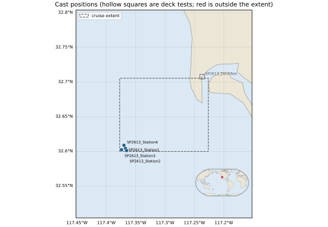

# Example outputs

What sbe-qa-processing writes, for one real cruise: **SP2613**, R/V Robert Gordon Sproul, a day
off San Diego on 2026-07-09 (R2R CTD fileset 169847): an SBE 911plus with dual temperature and
conductivity, four stations and a deck test.

| Directory | Command | Files |
|---|---|---|
| [`run/`](run/) | `run`, the core QA, as the OpenVDM hook writes it | [the PDF report](run/SP2613_qa_report.pdf), [the cast map](run/SP2613_plots/cast_map.svg) and [Station 1's pressure record](run/SP2613_plots/SP2613_Station1_pressure.svg) |
| [`r2r/`](r2r/) | `r2r run`, with R2R's CTD tests | [the PDF report](r2r/SP2613_169847_qa_report.pdf), with R2R's certificate after the title block, and [the R2R QA 2.0 XML](r2r/SP2613_169847_qa.2.0.xml) |

Left out for size, or because they hold local paths: the other figures (every one is in the
PDFs; a station's profiles are 2 MB as SVG) and the notebooks.



## Rebuilding them

From a clone, after a change to the reports. SP2613's fileset is committed in `tests/data/`, and
`uv run pytest` unpacks it into `data/`:

```bash
[ -d data/SP2613_169847_ctd ] || (mkdir -p data && tar -xJf tests/data/SP2613_169847_ctd.tar.xz -C data)
uv run sbe-qa-processing fetch-map-data   # the map's coastlines
rm -rf output/examples
uv run sbe-qa-processing run data/SP2613_169847_ctd -c tests/configs/SP2613.toml -o output/examples/run
uv run sbe-qa-processing r2r run tests/configs/SP2613.toml data/SP2613_169847_ctd -o output/examples/r2r
cp output/examples/run/SP2613_qa_report.pdf docs/examples/run/
cp output/examples/run/SP2613_plots/{cast_map,SP2613_Station1_pressure}.svg docs/examples/run/SP2613_plots/
cp output/examples/r2r/SP2613_169847_{qa_report.pdf,qa.2.0.xml} docs/examples/r2r/
```

Run them from the repository's root, so the reports name the fileset by its relative path,
`data/SP2613_169847_ctd`.
